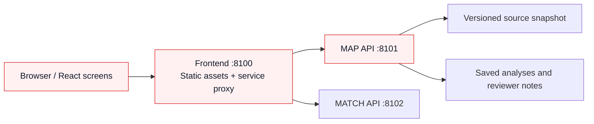
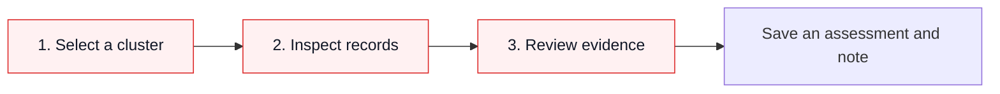

# CAPA.AI | Common frontend

**One browser interface for the CAPA.AI services, with MAP and MATCH connected.**

This React application follows the supplied frontend design. Users can explore recurring deviation patterns, inspect cluster members, read original source fields and save reviewer annotations through the independent MAP backend.

A deviation is a recorded departure from an expected process. CAPA means corrective and preventive action.

| At a glance | Details |
|---|---|
| Stack | React 18, TypeScript, Vite and Tailwind CSS |
| Runtime | Node.js 22 or later; npm |
| Local address | http://127.0.0.1:8100 |
| MAP workspace | http://127.0.0.1:8100/map |
| MATCH workspace | http://127.0.0.1:8100/match |
| Current integration | MAP on port 8101; MATCH on port 8102 |
| AUTHOR workspace | `/author` — prototype with synthetic data |

[Architecture](#how-the-frontend-connects) / [Setup](#run-locally) / [Screens](#what-you-can-do-today) / [Configuration](#configuration) / [Troubleshooting](#troubleshooting) / [Deployment](#deployment)

## Where this fits

| Repository | Responsibility | Port |
|---|---|---|
| **This repository: common frontend** | Browser screens, navigation and API presentation | 8100 |
| [MAP backend](https://github.com/arshad-ali-tfs/capa-ai-map-backend) | Analyses, clusters, source evidence and saved notes | 8101 |
| [MATCH backend](https://github.com/arshad-ali-tfs/capa-ai-match-backend) | Similar-record search API | 8102 |
| [AUTHOR backend](https://github.com/arshad-ali-tfs/capa-ai-author-backend) | Investigation and CAPA authoring API | 8103 |

The backends are independent services using copies of the same versioned source export. The frontend reads MAP and MATCH over HTTP; it does not read the CSV/database directly or run models. AUTHOR is an imported prototype using an in-memory mock service and synthetic data; it is not connected to the AUTHOR backend. The other planned-module cards remain placeholders.

## How the frontend connects



A **proxy** forwards an API request from the frontend server to MAP. The browser requests `/map/dataset` on port 8100; the server forwards it to MAP on 8101 and returns its response. Annotation reads/saves use the same path through `/api/v1/map/...`.

The browser stays on one origin, with backend addressing and authentication handled by the server. `config/serviceRegistry.mjs` defines service addresses and routes for both the production server and Vite. Set `MAP_API_TARGET` and `MATCH_API_TARGET` for their respective backends. Optional bearer tokens remain server-side. Model credentials belong in the backend, never in React's `VITE_*` variables.

## MATCH workspace

Start the independent MATCH backend with its source snapshot, local MPNet model and prepared index, then open `/match`. For Docker setup, use `Run-Match.ps1` in that backend repository. The current native installation can also use the parent workspace's `Start-CAPA.ps1` launcher.

Enter 8–30,000 characters, choose one allowed site or all allowed sites, and request up to 10, 25 or 50 results. Select a candidate to load its indexed description/conclusion and source-linked CAPAs. Hybrid scores combine meaning (70%), BM25 keyword relevance (20%) and word overlap (10%); they are not probabilities of correctness. Search runs locally without OpenAI calls.

| Operation | Contract |
|---|---|
| `GET /api/v1/match/index` | Searchable coverage, allowed sites, source identity and mock-embedding flag |
| `POST /api/v1/match/facets` | Site scope + structured filters; authorized choices and counts |
| `POST /api/v1/match/search` | Query (optional), site scope, explicit mode, filters, limit and optional page offset |
| `POST /api/v1/match/overview` | Server-issued search ID; short AI overview with source citations |
| `GET /api/v1/match/matched-records/{pr_id}?site=...` | Exact source ID and site; returns indexed fields and `related_capas` |

The API does not expose a refresh timestamp, so the screen reports index coverage. Details must match the selected source ID, site and snapshot. Missing CAPA links do not establish whether a CAPA is required or exists elsewhere.

The experimental branch `codex/match-search-experiments-20261119` requires the same MATCH backend branch. It adds site, multiple opened years, criticality, DR type, department, inclusive opened dates and CAPA-link filters. Multiple values within a field mean OR; different fields mean AND. Counts update before applying a search. Blank input browses filtered history with pagination; changing the form preserves and labels the previously submitted results until applied.

Search now leads the page. Filters and manual search modes start collapsed behind **Filters**, while selected chips remain visible. Smart mode can interpret explicit years/ranges, site and criticality from a sentence, clarify pharmaceutical wording and review candidate relevance. The original query stays editable, and the clarified wording/actual criteria are shown above results. Equipment/document anchors stay exact. The frontend sends `assist:true`; existing AUTHOR clients retain their separate original backend contract.

The independent Evidence overview reads up to six returned records and displays three short cited lines: AI synthesis of the pattern/findings and a CAPA-status line computed from retained source links. Clicking a deviation reference opens its existing source detail. Source results do not wait for summary generation; retries, cancellation, source-version checks and stale-response protection apply independently. Reviewed/returned counts make the sample scope visible. AI assessments and summaries support source review; they do not establish the current case's cause or CAPA effectiveness. Configure the optional provider/key only in the backend; none are included in the browser bundle.

Smart mode detects deviation IDs, short equipment/document references and keywords; unknown IDs do not fall back to unrelated records. Keywords require all terms, Exact phrase preserves a phrase, and Meaning supports related descriptions without hard identifier requirements. Literal matches inspect description, conclusion, recorded title and available investigation text from the matching snapshot. Evidence highlights and source-field labels explain each match. Investigation text is explicitly labelled as literal-search evidence rather than semantic-index content. Numeric-only Smart input means deviation ID; select Keywords to find numeric references in source text.

Manual Meaning/explorer scores also compare the recorded event title with the query; the tooltip explains the weights. Assisted Smart results show order and source evidence instead of a pseudo-confidence number. Browse and literal results show counts without fabricated scores. Model warm-up, service errors, empty results, stale requests and source-version mismatches are handled explicitly. The existing backend's original narrative contract remains available to AUTHOR.

## Run locally

Run commands from **this repository's root** unless another directory is stated. You need **Node.js 22+**, npm and a running MAP backend.

### 1. Start MAP

In the MAP backend repository, start its configured Docker service:

```powershell
# Prepare and start MAP without submitting a new paid analysis.
powershell -NoProfile -ExecutionPolicy Bypass -File .\Run-Map.ps1 -ServeOnly
```

The launcher handles fresh Docker setup and source/model checks. MAP needs a source snapshot and completed analysis to display. To reuse existing results without another paid run, restore the corresponding saved run folders and source snapshots under the backend data directory before starting. For a new analysis, follow the pipeline options in the backend README. A fresh backend clone does not include this workstation's saved results; follow the [MAP setup guide](https://github.com/arshad-ali-tfs/capa-ai-map-backend#run-locally).

### 2. Install and run the frontend

For a fresh checkout:

```powershell
git clone https://github.com/arshad-ali-tfs/capa-ai-frontend.git
cd capa-ai-frontend
npm ci
npm run build
npm run start
```

Skip cloning if the folder already exists. Open **http://127.0.0.1:8100/map**. Keep the frontend terminal open; stop it with **Ctrl+C**. MAP runs in a detached Docker container and stays running after its setup terminal closes.

When dependencies and `dist` already exist, only `npm run start` is needed. Rebuild after source changes. Starting backend containers does not also start this Node server.

### 3. Develop with live reload

Use this instead of `npm run start`:

```powershell
npm run dev
```

Development also uses port 8100. Run one frontend server at a time. Start the backend for the workspace you want to use; MAP and MATCH remain independent.

### Check the connection

```powershell
Invoke-RestMethod "http://127.0.0.1:8100/map/dataset"
```

A successful response contains `analysis`, `clusters` and `records`. Coverage figures describe the selected saved analysis; they are not application limits, and the UI does not imply that every source record was analysed.

Use **Analysis run** above the MAP workspace to open a previous completed result. Options show the record count, date and run ID; synthetic analyses are marked **Test**. The selected run is kept in the URL while navigating, filtering and reloading. Choosing **Latest analysis** returns to the backend's default result. Save or discard reviewer edits before switching; annotations stay attached to their original run.

## What you can do today



| Area | Available behavior |
|---|---|
| Home | Supplied shell and module entry points |
| Overview | Cluster table, filters, charts and analysis coverage |
| Cluster detail | Member records, source dimensions, historical context and explicit CAPA relationships |
| Evidence review | Original source fields, saved 5W1H extraction, matching context and reviewer notes |
| Navigation | Filters retained in URLs; consistent guided investigation across screens |
| Review | Saved assessments/notes with revision and conflict checks |
| Responsive layout | Desktop, tablet and phone layouts with source/review navigation |
| Refresh | Manual refresh plus checks every minute and when returning to the app |

Source text retains its original content and line breaks, using explicit backend field boundaries. Headings inside a narrative do not create new source fields. Older API responses remain readable as complete source text.

Unsaved notes pause refresh and prompt before leaving. Failed refreshes keep the previous valid dataset visible. Saving an annotation does not approve a cluster summary, reassign a record or update TrackWise.

### Understand the numbers

- **Deviations:** records in the current filtered analysis.
- **Criticality:** separate Minor, Major and Critical counts and shares of the filtered deviations, with unknown classifications identified; the UI does not predict severity.
- **Top DR types:** the top three known deviation record types and their cumulative contribution to all filtered deviations, including unknown types in the denominator.
- **CAPA implemented / raised:** distinct linked CAPAs marked Closed - Done divided by all distinct linked CAPAs raised in the current scope. A CAPA linked to multiple deviations is counted once.
- **Similarity:** average of available record-level similarities within the group/filter, not clustering accuracy or a probability of correctness.
- **Source coverage:** analysed record count compared with the available imported source.

The application loads API data. Fictional browser-test fixtures live under `tests/`; they are not an application fallback. Missing data is shown as unavailable. Saved analysis selection is available above MAP; historical search and indexed record inspection are available in MATCH. AUTHOR frontend integration is pending.

## Configuration

Defaults work with a native or Docker MAP backend published on host port 8101. For a different target, create local `.env` from [.env.example](.env.example), if absent, and edit:

```dotenv
MAP_API_TARGET=http://127.0.0.1:8101
PORT=8100
```

Restart after changing server configuration.

| Setting | Purpose |
|---|---|
| `MAP_API_TARGET` | Server-side MAP address, in production server and Vite proxy |
| `MAP_API_BEARER_TOKEN` | Optional server-side token for that upstream |
| `PORT` | `npm run start` port; default 8100 |
| `FRONTEND_HOST` | Production bind address; default `127.0.0.1` |
| `DATABRICKS_APP_PORT` | Deployment-provided port; takes priority over `PORT` |
| `MATCH_API_TARGET` | MATCH backend URL; defaults to `http://127.0.0.1:8102` |
| `MATCH_API_BEARER_TOKEN` | Optional MATCH token, used only by the server |
| `VITE_MAP_API_URL`, `VITE_MATCH_API_URL` | Optional browser API-base overrides; normally leave unset and use the proxy |
| `VITE_API_BASE_URL` | Legacy MAP browser override; `VITE_MAP_API_URL` takes precedence |

Vite development/preview uses port 8100 from `vite.config.mjs`; `PORT` controls the production Node server. If MAP uses Docker host port 18101, set `MAP_API_TARGET=http://127.0.0.1:18101`.

This repo currently has **no Dockerfile**. The three backend images are separate from this Node build/server.

## API contract and saved reviews

| Request through the frontend | Purpose |
|---|---|
| `GET /map/dataset` | Default analysis, clusters, records, source sections, saved 5W1H and annotations |
| `GET /api/v1/map/runs?limit=100000` | List saved analyses for the run selector |
| `GET /api/v1/map/runs/{run_id}/dataset` | Load the selected analysis and its own saved outputs |
| `GET /api/v1/map/runs/{run_id}/annotations` | Read saved record annotations |
| `PUT /api/v1/map/runs/{run_id}/records/{record_id}/annotation` | Save `assessment`, `note` and `expected_revision` |

The API service validates the dataset shape before displaying it. HTTP **409** means a saved annotation revision changed; reload the latest version before retrying. Notes live in the MAP backend's `record_annotations.json` under its persistent run folder, not solely in this browser or repository.

The proxy forwards only the MAP, MATCH and AUTHOR paths registered in `config/serviceRegistry.mjs`; unknown `/api/` paths return 404. Full MAP schemas are in the running [MAP API docs](http://127.0.0.1:8101/docs).

## Find your way around

```text
src/app/                   Shell, route parsing and navigation
src/features/landing/      Home/module-entry screen
src/features/map/          Screens, data provider, filters and review state
  components/              Source reader, tables, guided steps and review panels
  services/mapService.ts   HTTP calls and response validation
src/shared/                Reusable UI, helpers and HTTP client
public/                    Static assets
server.mjs                 Production static server and service proxy
vite.config.mjs            Development/preview proxy and build setup
tests/                     Browser checks and fictional fixtures
dist/                      Generated build; not committed
```

## Verify your changes

```powershell
npm run typecheck
npm run build
npx playwright install chromium
npm test
```

Default browser checks use fictional API fixtures across desktop, tablet and phone layouts. Tests start or reuse the local frontend server. To run applicable checks with a real MAP backend:

```powershell
$env:MAP_REAL_DATA = '1'
npm test
Remove-Item Env:MAP_REAL_DATA
```

[VERIFICATION.md](VERIFICATION.md) records the checks, screenshots and skipped-test boundaries. Display tests do not establish model accuracy. Docker MAP-to-frontend HTTP connectivity was also verified without changing the proxy configuration.

## Troubleshooting

| Symptom | Check |
|---|---|
| Node/npm unavailable | Install Node.js 22+ and reopen the terminal |
| `Run npm run build first` | `npm run start` serves `dist`; build before starting |
| MAP unavailable / HTTP 502 | Start MAP, test its `/api/v1/map/health`, check `MAP_API_TARGET` |
| API responds but dataset is unavailable | MAP needs a completed analysis and matching source snapshot |
| Source changes do not appear | Rebuild `dist`, or use `npm run dev` while editing |
| Port 8100 occupied | Stop the existing frontend server; Vite uses a strict port |
| Save fails with 409 | Another save changed its revision; refresh before retrying |
| MATCH unavailable / HTTP 502 | Start MATCH on port 8102 and check `MATCH_API_TARGET` |
| No AUTHOR page | AUTHOR frontend integration is pending |

## Deployment

The frontend deploys separately from the backends. [DEPLOYMENT.md](DEPLOYMENT.md) describes Databricks Apps preparation and the `app.yaml` start command.

Build static assets and run the Node server. The existing `app.yaml` uses the Databricks App resource `map-api-target` for `MAP_API_TARGET`; grant the frontend identity CAN_USE on that backend. Targets can be explicit URLs, hostnames, or App resource names inside Databricks Apps. Injected app credentials provide automatic server-side OAuth acquisition and renewal. Optional per-service bearer tokens override managed authentication for that service only. Configure MATCH/AUTHOR targets and permissions when deploying them. Keep model keys in the backends. Local regression checks are verified; Databricks deployment still needs target-workspace acceptance checks.

MAP review warnings come from the backend. Close scores do not trigger Needs review. Missing historical names or descriptions appear once on the cluster detail screen using the cluster's `warnings` array; they do not flag individual records or increase record review counts. Record warnings, including unavailable assignments, remain on the relevant evidence screen. Viewing a warning does not make an LLM call.

The record review screen includes a 5W1H extraction panel below the source narrative. It shows the six saved AI output categories for the selected record and analysis. Unavailable categories are labelled clearly. This reads existing results without rerunning the pipeline or calling the model.

Cluster context shows the saved AI summary for the selected analysis, with a separate expandable historical reference where available. The summary covers all records in that saved cluster; changing filters does not regenerate it. Historical cluster names stay stable, with the saved analysis title used when a historical name is missing. Summaries and confidence labels remain AI output for review, not measured accuracy or approved historical definitions. Older results without a saved analysis summary fall back explicitly to the historical reference or an unavailable state.


## MAP deadlines, CAPA filters and cluster groups

On-time closure replaces Active clusters. For Minor, Major and Critical, it shows closures on/before the recorded DATE_TO_CLOSE divided by assessable closed deviations in the current view. DATE_CLOSED supplies the closure date. Same-day closure is on time. Cancelled/open records and missing, invalid or contradictory date/status data are excluded; unavailable rates display a dash. The recorded deadline can already include extensions; original deadlines are not reconstructed.

CAPA linkage and CAPA status filters select the deviation cohort through retained parent/root-parent links. The CAPA KPI continues to count all distinct CAPAs linked to that resulting cohort. Due-date status distinguishes closed late, open overdue and on-time records; open overdue uses the current UTC date and the saved source status. Filters and cluster groups remain in links across details/evidence and reload, and Clear all resets them together.

Cluster groups use 11 predefined quality categories plus Other / needs classification. Assignment is suggested from cluster titles and record types. Other stays last in both the group cards and the filter. Selecting a group narrows the records and analysis KPIs while retaining the original analysis assignments and outputs.


### Deviation insights layout (22 November 2026)

Five cards sit in Deviation insights above Guided investigation. On-time closure,
criticality and CAPA implemented / raised form the summary row; Top DR types and
Top stages form a matching pair of rankings underneath. The layout adapts to the
available content width and retains readable percentages at 125% zoom. Ranked
names, counts and shares precede their combined contribution. CAPA linkage, CAPA
status and Due-date status remain in More filters with visible active chips.

The four analysis KPIs follow the current filters. Top stages covers all distinct
deviations in the verified source opened in the past 12 months. Its full-source
denominator and exact dates are visible; its tooltip explains stage mapping,
missing coverage and independence from the analysis filters and cluster groups.
Client and product cards are omitted because this source has no usable deviation
client values or structured product identity. No names are inferred from text.
The stage card uses MAP `/runs/{run_id}/insights`; loading, no-data and failure
states stay within that card, with an independent retry.


### MATCH direct answers and historical watchlist (21 November 2026)

Question searches produce a source-verified answer first, with a question-specific
evidence gap when the returned excerpts do not support an answer. Keyword searches
retain the overview format. Supporting original quotes are available in the summary.

Selected deviations have Details / Watchlist tabs below severity/status badges.
Watchlist loads only when opened and is independent of the AI summary. It counts
distinct other same-site MATCH-eligible indexed deviations across all retained dates,
not only the returned search candidates. Current search filters do not narrow it.
Equipment/location mentions and title/description event indicators are separate;
these are historical review signals, not proof of recurrence, causation or CAPA
effectiveness. Dates, yearly counts, recent counts and exact supporting excerpts are
provided. Other records can be inspected without replacing the search results.
